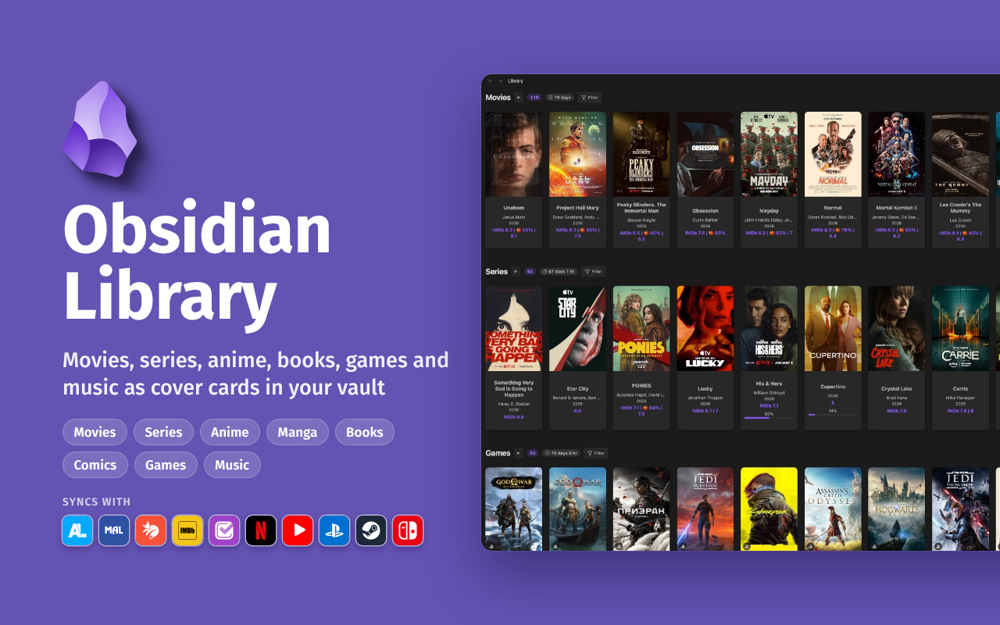

<p align="center">
  
</p>

<h1 align="center">Library</h1>

<p align="center">
  <a href="https://www.typescriptlang.org/"></a>
  <a href="https://obsidian.md/"></a>
  <a href="https://community.obsidian.md/plugins/library"></a>
  <a href="https://github.com/venvk/obsidian-library-plugin/releases"></a>
  <a href="https://github.com/venvk/obsidian-library-plugin/releases"></a>
  <a href="https://github.com/venvk/obsidian-library-plugin/stargazers"></a>
  <a href="https://github.com/venvk/obsidian-library-plugin/blob/main/LICENSE"></a>
</p>

<p align="center">
  Your movies, series, anime and manga, books, games, comics and music as plain Markdown notes,<br>
  shown as a gallery of covers. Search a title, pick it, and the note fills itself in.
  <br><br>
  <a href="https://community.obsidian.md/plugins/library">Install</a> · <a href="https://github.com/venvk/obsidian-library-plugin/wiki">Wiki</a> · <a href="https://github.com/venvk/obsidian-library-plugin/issues/new/choose">Report a bug</a>
</p>

## What it does

- **One note per title.** The note keeps the cover, year, genres, creators, cast, ratings and trailer. All of it sits in the note's properties (frontmatter), so Bases, Dataview and other plugins can read it.
- **Progress you can tick.** Episode and chapter lists live at the top of the note. Tick them off as you go, rate them, and see when the next episode airs.
- **A library view.** One section per kind of media, with filters and sorting by rating, date or progress, an "Up next" shelf, and a "Soon" list with the air dates of new episodes.
- **Statistics.** How many titles you have, how many hours of watching or reading that is, and fun comparisons like "in that time you could have watched every Bond film". It also shows your taste (how your scores compare with other viewers, your favourite genres and decade) and your latest diary entries.
- **A diary.** Tick an episode or a chapter, or mark a title complete, and the day goes into the note's `Log` property.
- **Library blocks.** A `library` code block in any note shows cards picked by category, genre, year or score, what you are in the middle of, the Soon list or the statistics.
- **A library map.** One command draws your library as a canvas, with posters grouped around the actors and creators they share.
- **Covers offline.** Turn on "Keep covers in the vault" and covers are saved to a Covers folder, so the library looks the same without internet.
- **Linked canvases.** Genres, creators and actors are links. Open Horror and a canvas shows the covers of every horror title in your library, by category.
- Works on desktop and mobile, in every Obsidian language.

## Getting started

1. In Obsidian open **Settings**, then **Community plugins**, search for **Library**, install and enable it.
2. Click the Library icon on the left sidebar and press **+**.
3. Pick a kind, search, choose a result. Each kind gets its own category and folder, created with its first title.

Same name, different films? Add the year: `dune 1984`.

## Connect and sync

Connect an account in the plugin settings. Your lists arrive as notes, and anime progress and scores stay in sync.

-  **AniList**: anime and manga lists, progress and scores; changes go back with the Push command
-  **MyAnimeList**: anime and manga lists, progress and scores; changes go back on save
-  **Kitsu**: anime list, progress and ratings; changes go back on save
-  **IMDb**: ratings, episode ratings and watchlist; scores and new watchlist titles go back
-  **Netflix**: viewing history and thumbs, anime into the anime category; scores go back as thumbs, unticked episodes leave the history, and series you haven't started go to My List
-  **Trakt**: watch history, ratings and watchlist; scores, ticked and unticked episodes and new watchlist titles go back
-  **PlayStation**: played games, playtime and trophies
-  **Steam**: library, playtime and achievements
-  **Nintendo Switch**: played games and playtime

Imports run once a day on desktop. Your own scores are never overwritten, and progress never moves backwards. IMDb, Netflix, PlayStation, Steam and Nintendo work on desktop only. Trakt also signs in and sends changes from mobile. When you delete a note, the plugin asks whether to remove the title from the connected sites too.

## Sources

Each category searches open sources. An API key adds richer data, and its service is tried first.

| Category | Open sources | With a key |
| --- | --- | --- |
| Movies, series | Cinemeta, Wikidata | [OMDb](https://www.omdbapi.com/apikey.aspx), [TMDB](https://www.themoviedb.org/settings/api) for season ratings and episode images |
| Books | Open Library | [Google Books](https://console.cloud.google.com/apis/library/books.googleapis.com) |
| Games | Steam, Wikidata | [RAWG](https://rawg.io/apidocs), [Twitch](https://dev.twitch.tv/console/apps) (game trailers) |
| Anime, manga | AniList, MyAnimeList, Kitsu | None |
| Comics | Wikidata, AniList | [Comic Vine](https://comicvine.gamespot.com/api/) |
| Music | Deezer | None |

Anime and manga notes take English, romaji or original names, as you choose in the settings. Titles marked adult stay out of search until you turn them on.

Anything that doesn't fit goes into a Manual category with your own fields. More in the wiki: [sources and keys](https://github.com/venvk/obsidian-library-plugin/wiki/Sources-and-API-keys), [frontmatter](https://github.com/venvk/obsidian-library-plugin/wiki/Frontmatter-reference), [anime sync](https://github.com/venvk/obsidian-library-plugin/wiki/Anime-sync).

**A note from the library**

```yaml
---
Type: Series
Name: Stranger Things
Year: 2016
Rating IMDB: 8.7
My Rating: 9
Cover: https://images.metahub.space/poster/medium/tt4574334/img
Progress: 8/42
Date: 01.03.2026
Source: omdb
Source ID: tt4574334
---
```

`Progress: 8/42` means 8 of 42 episodes watched. Genre, creator and cast are written as links to their canvases. Refreshing a note fills in empty fields and updates ratings from the source. It never overwrites your own rating or progress.

<details>
<summary><b>Commands</b></summary>

- Open Library · Add content · Search your library
- Refresh metadata for current note · Refresh metadata of all notes
- Rebuild graph links · Find & remove duplicates · Share current note
- Import from AniList, MyAnimeList or Kitsu · Push and pull progress for each
- Import Steam library · Import PlayStation games and trophies · Import Nintendo games
- Import from Trakt · Build library map
</details>

## Privacy

Your library is plain notes and opens offline. The plugin only goes online to search, refresh, sync or share, and never more often than once every 5 minutes for the same note. No telemetry, no self-update. Each API key is sent only to its own service, and sign-ins happen on the service's own page, so the plugin only ever stores the token.

Nintendo accepts requests only from its own app, so they pass through a third-party signing service ([nxapi-znca-api](https://github.com/samuelthomas2774/nxapi-znca-api)). The plugin asks before you sign in.

<details>
<summary><b>Every host the plugin contacts</b></summary>

| Hosts | Use | Data sent |
| --- | --- | --- |
| `www.omdbapi.com`, `m.media-amazon.com` | Movie search with a key, posters | Title or IMDb id, key |
| `v3-cinemeta.strem.io`, `images.metahub.space`, `episodes.metahub.space` | Movies, series, stills, air dates | Title or IMDb id, genre |
| `api.themoviedb.org`, `image.tmdb.org` | Movie and series details, with a key | IMDb id, key |
| `www.wikidata.org`, `en.wikipedia.org`, `upload.wikimedia.org` | Search, Rotten Tomatoes, trailers, covers, matching Netflix titles | Search text, ids, Netflix ids |
| `openlibrary.org`, `covers.openlibrary.org` | Books, chapters, covers | Title, author, ISBN, genres |
| `www.googleapis.com`, `books.google.com` | Book search with a key, covers | Title, key |
| `api.rawg.io`, `media.rawg.io` | Games, with a key | Title or id, genre, key |
| `store.steampowered.com`, `steamcommunity.com`, `api.steampowered.com`, `cdn.cloudflare.steamstatic.com`, `video.akamai.steamstatic.com`, `shared.akamai.steamstatic.com`, `shared.fastly.steamstatic.com` | Games, trailers, Steam import, achievements | Title or app id; sign-in, library and achievements on import |
| `www.imdb.com`, `api.graphql.imdb.com` | IMDb connector | Sign-in; ratings and watchlist are read, scores and new titles are sent, removals of deleted notes |
| `www.netflix.com` | Netflix connector | Sign-in; viewing activity and thumbs are read, scores are sent as thumbs; unticked or deleted titles are hidden from the history, unstarted series go to My List |
| `api.trakt.tv`, `auth.trakt.tv` | Trakt connector | Sign-in code; history, ratings and watchlist are read, scores, watched and unwatched episodes, watchlist titles and removals of deleted notes are sent |
| `id.twitch.tv`, `api.igdb.com` | Game trailers, with Twitch keys | Twitch id and secret, game |
| `api.deezer.com`, `cdn-images.dzcdn.net` | Music search, covers | Album or artist |
| `graphql.anilist.co`, `anilist.co`, `s4.anilist.co`, streaming services' image hosts | Anime, manga, air dates, sync | Title or ids; token, progress, status, score |
| `myanimelist.net`, `api.myanimelist.net`, `api-cdn.myanimelist.net` | Anime and manga search, sign-in, import, sync | Search text; token, progress, status, score |
| `kitsu.io`, `kitsu.app` | Anime search, sign-in, import, sync | Search text; token, progress, status, score |
| `ca.account.sony.com`, `my.account.sony.com`, `m.np.playstation.com`, `web.np.playstation.com`, `image.api.playstation.com`, `psnobj.prod.dl.playstation.net` | PlayStation sign-in, games, trophies, covers | Token |
| `accounts.nintendo.com`, `api.accounts.nintendo.com`, `api-lp1.znc.srv.nintendo.net`, `atum-img-lp1.cdn.nintendo.net` | Nintendo sign-in, play activity, covers | Session token |
| `nxapi-auth.fancy.org.uk`, `nxapi-znca-api.fancy.org.uk` | Signing service for Nintendo requests | Nintendo Account id token, account id, the app's requests and answers |
| `comicvine.gamespot.com` | Comic search, with a key | Title, key |
| `www.youtube.com`, `www.youtube-nocookie.com`, `i.ytimg.com`, `player.vimeo.com`, `www.dailymotion.com` | Trailers | Video id |
| `twitter.com`, `t.me`, `wa.me`, `www.reddit.com`, `www.facebook.com`, `www.linkedin.com`, `vk.com`, `bsky.app`, `www.pinterest.com` | Share buttons | Caption with title, score and link; the image stays local |

`specs.openid.net` only names the OpenID fields in the Steam sign-in request; nothing is sent to it.
</details>

## Support

Questions go to [Discussions](https://github.com/venvk/obsidian-library-plugin/discussions), bugs and ideas to [Issues](https://github.com/venvk/obsidian-library-plugin/issues/new/choose). Released under the [MIT License](LICENSE).

<a href="https://buymeacoffee.com/venvk"></a>

<details>
<summary>Crypto</summary>

| Network | Address |
| --- | --- |
| EVM | `0xf9B4807E107f6f8Db79D86aCef6072A31d570201` |
| Sui | `0x1d6989810ee7e55d43f65398253b02462b921e9ce8ad626b542929f02c3d3e9a` |
| Sol | `2jmrmQrLVeUDFgHzSkHvHKBrmRJXes5X8h3GHXxrLaX6` |
| BTC | `bc1q4pdlj35uev8r0rgncpmn999n3jvj472pppds6r` |
| TON | `UQCphscY14j0AiRY1lGPciQjd9_XcRbUDyPLDxG4O1unEpgM` |
| Tron | `TYhmDLfx7aGHL1ikmNN3t72oGB3DjBjydR` |

</details>
